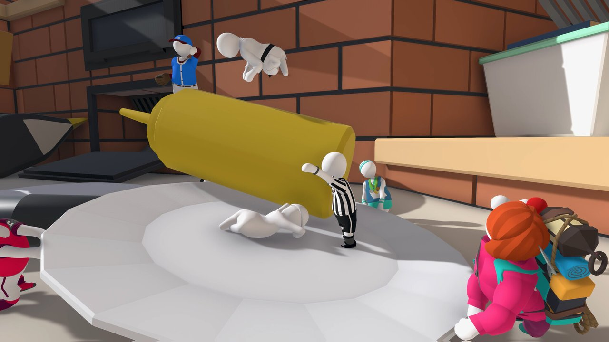

# 🏭 Level 2: Factory

> **Objective**: Maneuver through wobbly conveyor belts, stack heavy boxes to press pressure plates, operate crane levers, and cross the giant vacuum pipes to reach the level exit.
> **Level Matrix**: Difficulty ⭐⭐☆☆☆ | Est. Duration 15 Mins
> **Mechanics**: Conveyor friction, heavy gear momentum, crane arm manipulation, and box physics stacking.

---

  
  
📸 Factory Floor: Stack boxes on plates to activate electrical circuits and power doors.

---

## 🗺️ Step-by-Step Level walkthrough

### Stage 1: The Pressure Plate Room
*   **Walkthrough**: Drag the heavy wooden boxes from the conveyor belts, and stack them directly on the glowing green pressure plates. This keeps the electrical circuits powered, holding the metal doors open.

### Stage 2: Moving Conveyor Belts ⛓️ Key Obstacle
*   **Walkthrough**: Climb onto the fast-moving conveyor belts. Run in the opposite direction (hold Shift) to stay balanced. Reach out with both hands to grab the steel beams overhead, and pull yourself up to the ventilation ducts.

### Stage 3: The Heavy Rotating Gears
*   **Walkthrough**: You will find two massive interlocking gears. Grab the tooth of the first rotating gear to let it lift you up. As you reach the top, quickly release and grab the next gear to transfer your momentum, then drop onto the safe catwalk.

### Stage 4: Operating the Crane Arm
*   **Walkthrough**: Move to the control desk. Grab and push the dual levers to swing the giant crane arm toward the center platform. Run, jump, and hang onto the crane hook. Swing the crane arm around to drop Bob safely onto the exit platform.

---

## 💡 Pro Tips & Glitch Hacks

  <strong>【Conveyor Belt Slingshot】</strong> 
  You can run on the fast conveyor belt in its moving direction and jump at the very edge. The conveyor's friction velocity will add directly to Bob's jump momentum, launching you over the barrier without doing the gear-climbing puzzles.

---

The steps above describe one possible route. Verify object placement and controls in your game version; this guide does not claim an official speedrun record or achievement unlock.

---

*Guides version: v1.2 | Signal synced... Next Level: [Guides Console](/guides/)*

<!--
########################################################################################################################
########################################################################################################################
########################################################################################################################
########################################################################################################################
########################################################################################################################
########################################################################################################################
########################################################################################################################
########################################################################################################################
########################################################################################################################
########################################################################################################################
-->

---

## 🔗 Continue Your Run

*   ⬅️ **Previous:** [1 Mansion Level Walkthrough](/guides/mansion/)
*   ➡️ **Next:** [3 Train Level Walkthrough](/guides/train/)
*   🧠 **Stuck on the physics?** [Physics Tips & Movement Tricks](/gameplay/physics-tips/)
*   👥 **Playing with friends?** [Multiplayer Co-op Guide](/multiplayer/)
